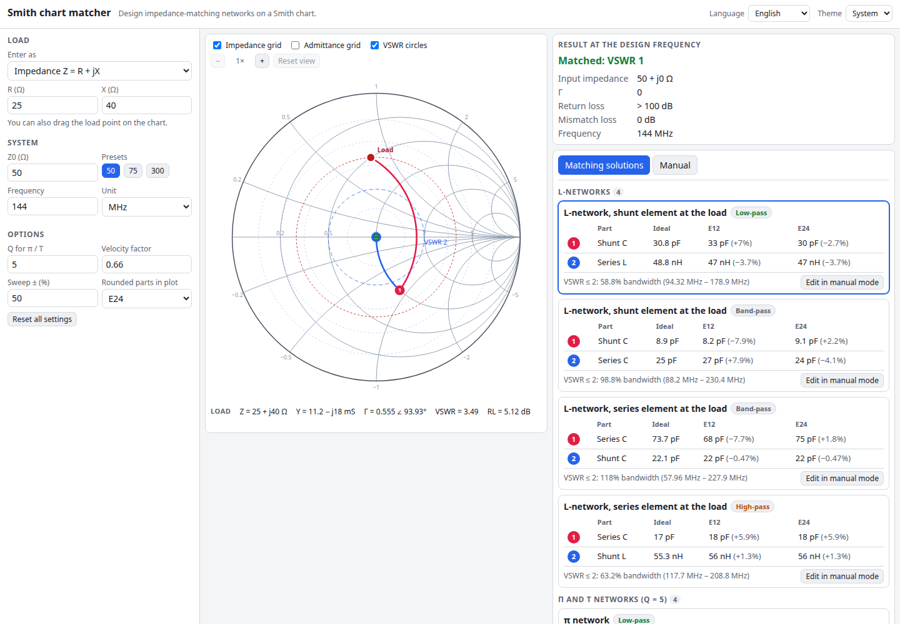

# Smith Chart Matcher

An interactive Smith chart and impedance-matching designer that runs entirely in your browser. Enter a load (as Z, Γ or return loss), or just drag the load point on the chart, and it lists every L-network, π and T network for your chosen Q, single shunt or series stub, and quarter-wave transformer that matches it to your line. Each solution comes with component values in pF and nH, the nearest E12 and E24 parts, the trajectory on the chart and the matched VSWR / |S11| over a frequency sweep.

**Try it: [hermes98761234.github.io/smith-chart-matcher](https://hermes98761234.github.io/smith-chart-matcher/)**

[](https://github.com/hermes98761234/smith-chart-matcher/actions/workflows/deploy.yml)



## Features

- **Interactive Smith chart** (SVG): impedance and admittance grids, VSWR circles, wheel / button zoom with panning, and a draggable (or arrow-key movable) load point with a live Z, Y, Γ, VSWR and return-loss readout under the cursor.
- **Flexible input:** load as R + jX, as |Γ|∠θ, or as return loss plus phase. Source / line Z0 (default 50 Ω, presets for 75 and 300 Ω), design frequency in kHz, MHz or GHz, and a velocity factor for physical line lengths.
- **All the matches:**
  - L-networks in both topologies (shunt-then-series and series-then-shunt), each with its low-pass and high-pass variant, whichever exist for the load.
  - π and T networks (low-pass and high-pass) for a Q you choose, with complex loads absorbed into the adjacent element.
  - Single shunt or series stub, open or short, for both distance solutions.
  - Quarter-wave transformer, with a preceding line section when the load is complex.
- **Real parts:** values in pF / nH (or whatever prefix fits), the nearest E12 and E24 value with the error in percent, electrical and physical line lengths.
- **Trajectory on the chart:** numbered, colour-coded steps from the load to the matched point.
- **Matched frequency response:** |S11| in dB or VSWR over a sweep band, with the VSWR 2 limit, a cursor readout, the bandwidth for VSWR ≤ 2, an optional dashed curve with E12 / E24 rounded parts, and the unmatched load for comparison.
- **Manual mode:** add series or shunt L, C, R, transmission lines and open / short stubs, edit values with units, reorder them, and watch the path and response update. "Edit in manual mode" copies any solution there.
- **English and Ukrainian, light / dark / system theme**, settings remembered in the browser, usable on a phone. No backend, no tracking; nothing leaves your device.

## How it works

All the maths is plain TypeScript in `src/lib`, with unit tests against textbook results (Pozar's L-network example, quarter-wave and half-wave line identities, known Γ / VSWR / return-loss values, and a check that every solution lands exactly on Z0 for a spread of loads).

- `complex.ts`, `rf.ts`: complex arithmetic, Γ ⇄ Z, VSWR, return loss, mismatch loss.
- `network.ts`: element models (lumped L / C / R, series lines, open / short stubs), cascading from the load towards the source, the chart trajectory, the frequency sweep and the VSWR bandwidth.
- `matching.ts`: the L, π, T, stub and quarter-wave solvers. L-networks follow the admittance-circle / resistance-circle construction. π and T networks go through a virtual resistance set by Q. Stubs use the closed-form tan(βd) solutions, and the series stub is the exact dual of the shunt stub.
- `eseries.ts`, `format.ts`: preferred-value rounding and engineering formatting.

The sweep keeps the load constant over frequency and uses ideal, lossless elements. Lines and stubs keep their electrical length at the design frequency and scale linearly with f (a non-dispersive line of velocity factor `vf`). Series stubs assume a balanced or otherwise accessible line.

## Quick start

You need [Node.js](https://nodejs.org/) 22.

```bash
git clone https://github.com/hermes98761234/smith-chart-matcher.git
cd smith-chart-matcher
npm install
npm run dev       # http://localhost:5173
npm test          # complex math, matching solvers, E-series, i18n
npm run build     # static site in dist/
```

## License

MIT
